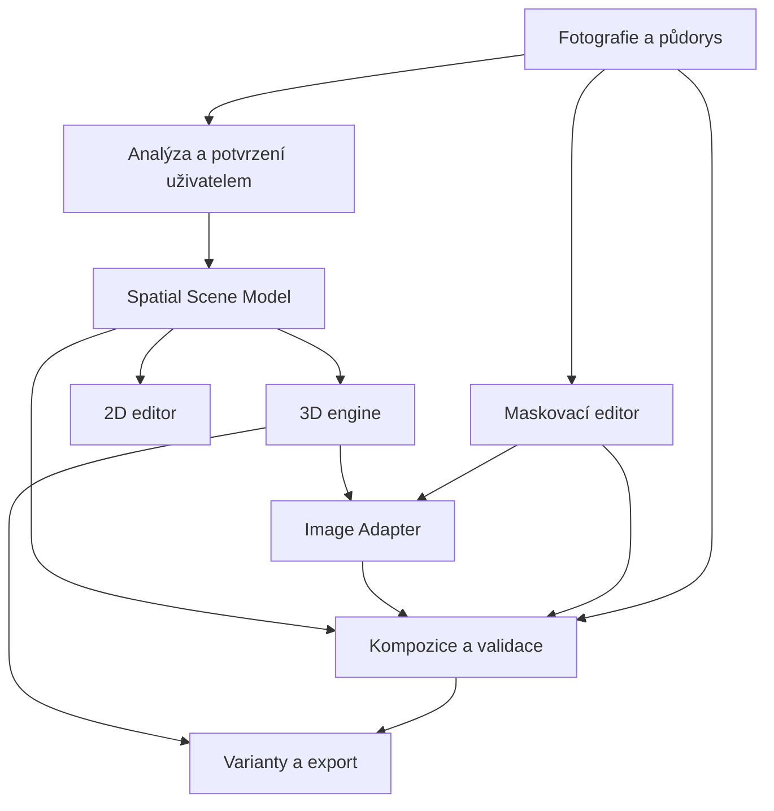

# Architektura

## Rozhraní a odpovědnosti
- ProjectStore: neměnné originály, verzované scény, masky v nativních souřadnicích, varianty a migrace.
- SceneService: validace, změny objektů, zámky, kolize; jediný zdroj geometrie pro 2D a 3D.
- MaskService: rasterizace, priority, povolená oblast a historie.
- ImageAdapter: capabilities(), generate(request); oddělený od UI, s kontrolou nákladů před voláním.
- CompositeService: přijímá originál, kandidáta a efektivní masku; vrací PNG a report integrity.
- GeometryValidator: kontrola kompatibility a stav verified / failed / unverified; neprohlašuje heuristiku za důkaz.
- Renderer: deterministická scéna, kamery a export; Blender volitelný.

## Datový tok a bezpečnost
Originál -> maska -> kandidát -> kontrola rozměrů a perspektivy -> kompozice -> kontrola pixelů -> export. Při chybě nepublikuj jako validní. Geometrické zámky v 3D vynucuj přímo při mutaci scény. Fotografie a 3D kamera jsou odlišné reprezentace; bez kalibrace nelze garantovat jejich shodu. Pixelový zámek platí pouze pro stejný pohled, nikoli novou kameru.

Názvy rozhraní jsou návrhy, přizpůsob je existujícímu kódu. Pro první etapu nepřidávej těžké ML závislosti.
